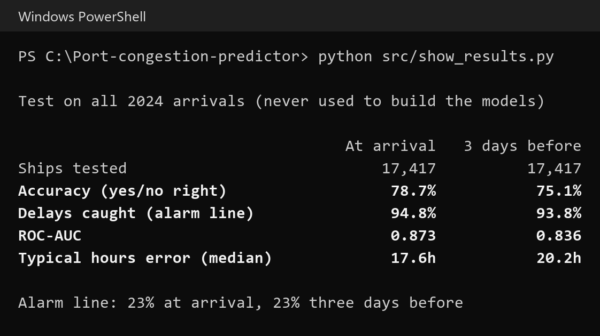
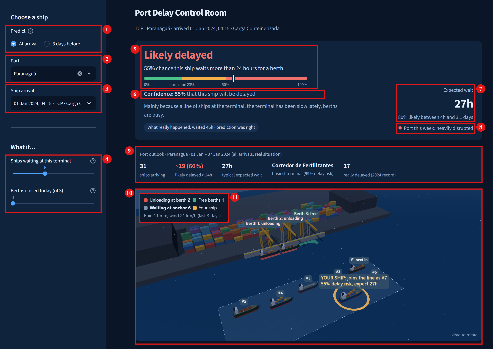
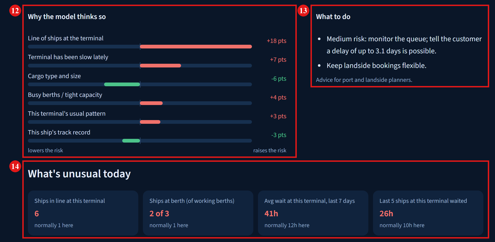

# Port Congestion & Ship Delay Predictor

**Will this ship wait more than 24 hours for a berth, how sure are we, and why?**

Project document (4 pages): [report/final/project_document.pdf](report/final/project_document.pdf)

## The problem

Ships queue for berths. When all of a port's berths are busy, arriving ships wait at anchor, and that wait is expensive: the ship sits idle, the cargo arrives late, and trucks and warehouses booked for it go unused. This happens at busy ports everywhere, and without a forecast a long wait usually becomes clear only when it is too late to re-plan.

**The task:** for every arriving ship, predict the **likelihood of delay**, give a **confidence score**, and **explain the key factors**, early enough for planners to act.

## Our approach

We built a system that predicts whether a cargo ship arriving at a Brazilian port will wait **more than 24 hours** before it gets a berth. For every ship it gives four things: the **chance of a delay**, a **confidence score**, the **expected wait in hours** with a likely range, and the **main reasons** in plain words. It can predict when the ship arrives, or **3 days earlier**, while there is still time to act.

It is trained on **85,606 real port calls** at Brazil's 15 busiest ports (2020–2024) from ANTAQ, the national waterway regulator, plus **daily weather at each port** (rainfall, maximum wind speed and wind gusts) from the free **Open-Meteo historical weather archive**. A demo app shows each prediction on a 3D view of the port, explains it, and lets a planner test "what if" changes such as more ships arriving or a berth closing.

| Moment | Who uses it | What they can do |
|---|---|---|
| **When the ship arrives** | Port and landside planners | Plan berths, trucks and warehouse slots |
| **3 days before** | The ship operator | Slow down to save fuel, warn the customer, or consider another port |

### How well it works

Tested on all **17,417 arrivals of 2024**, a year the system never saw while it was being built:

| Measure | When the ship arrives | 3 days before | What it means |
|---|---|---|---|
| **Accuracy** | **78.7%** | **75.1%** | Out of 100 ships, about 79 get the right yes/no answer. |
| **Delays caught** | **94.8%** | **93.8%** | Out of 100 ships that really waited more than 24 hours, the alarm went off for about 95. |
| **ROC-AUC** | **0.873** | **0.836** | Pick one delayed and one on-time ship at random: 87 times out of 100 the delayed one gets the higher risk. |
| **Typical hours error** | **17.6 h** | **20.2 h** | Half of all wait estimates are within about 18 hours of the real wait. |

## System architecture

The system is built on **four LightGBM models**. All four use the same **108 features** (line of ships, berths in use, recent waits, queue maths, the ship's previous voyage, cargo, weather, calendar), computed only from events **before** the prediction moment, and all four are **retrained on the 1st of every month** on every port call whose outcome is already known by that day.

- **Main model: LightGBM classifier (the delay model).** Answers *"will this ship wait more than 24 hours?"* and outputs **p, the chance of a delay**. 1,269 trees at arrival (773 for 3 days before), learning rate 0.01. From p come the **yes/no answer** (delayed if p ≥ 23%, because a missed delay is assumed to cost 3× a false alarm), the **confidence score** max(p, 1 − p), and the **reasons** (each feature's share of p, from TreeSHAP).
- **Range models: three LightGBM models for the waiting time.** Answer *"how long will it wait?"*
  - **Lower-bound model:** the shortest likely wait. Only 1 ship in 10 waits less.
  - **Expected-wait model:** the middle wait, shown as the expected wait.
  - **Upper-bound model:** the longest likely wait. Only 1 ship in 10 waits longer.

  Together they give the **expected waiting range**, widened slightly (conformal calibration) so the real wait falls inside it 80% of the time (79.8% on 2024).

## Results

The results on the 2024 test set can be reproduced with `python src/show_results.py`, which recomputes them from the saved predictions:



The app, for one real case: a container ship arriving at the TCP terminal in Paranaguá on 1 January 2024. The system gave a 55% chance of delay; the ship really waited 46 hours.



1. **Prediction moment:** predict when the ship arrives, or 3 days before.
2. **Port:** any of the **15 busiest Brazilian ports**.
3. **Ship:** any real 2024 arrival at that port (2,282 at Paranaguá).
4. **What-if sliders:** add ships to the line at this terminal, or close some of its berths (this terminal has **3 berths**); every number on the page updates.
5. **Verdict:** the chance of waiting more than 24 hours, on a gauge that marks the 23% alarm line.
6. **Confidence:** how likely the yes/no answer is to be right.
7. **Expected wait:** 27 hours, and the range the real wait falls in 80% of the time (4 hours to 3.1 days).
8. **Port status this week:** normal, slightly disrupted or heavily disrupted, from the port's average wait over the last 7 days.
9. **Port outlook:** for the whole port this week, the ships arriving, how many are likely to be delayed, the typical wait and the busiest terminal.
10. **3D view of the terminal:** its berths, the ships unloading, the ships waiting at anchor in order, and this ship highlighted.
11. **Live counts:** ships unloading, free berths, ships waiting at anchor, and the last 3 days of weather.



12. **What led to the delay:** the main causes, each with how many percentage points it adds to or removes from the chance of delay.
13. **What to do:** suggested actions for planners, based on the risk and the expected wait.
14. **Today vs a normal day:** today's situation next to this terminal's normal (its typical value in 2020–2022).

## What you need to download

| What | Version used | Notes |
|---|---|---|
| **Python** | **3.12.7** | [python.org/downloads](https://www.python.org/downloads/) |
| **Git** | 2.49.0 | To clone this repository. [git-scm.com](https://git-scm.com/downloads) |
| **Web browser** | any recent Chrome, Edge or Firefox | For the app; the 3D view needs WebGL. |
| **Disk space** | about 3.5 GB | 2.4 GB of ANTAQ data, ~0.5 GB of models and features. |
| **Internet** | needed once | To download the ANTAQ tables (Zenodo) and the weather (Open-Meteo). No accounts or API keys are needed. |

Python packages (installed by `pip install -r requirements.txt`, exact versions pinned):

| Package | Version | Used for |
|---|---|---|
| pandas | 3.0.6 | Loading and cleaning the port records |
| numpy | 2.5.4 | Feature maths |
| pyarrow | 26.0.0 | Reading and writing the data files (Parquet) |
| scikit-learn | 1.9.1 | Evaluation metrics |
| lightgbm | 4.7.0 | The four models |
| streamlit | 1.66.0 | The web app |
| requests | 2.34.2 | Downloading the data and weather |
| matplotlib | 3.11.2 | Calibration charts written by `train.py` |
| pytest | 9.1.1 | The automatic checks |

## How to run it

The data and trained models are not stored in this repository (they are large), so the first run downloads the data and builds everything.

```bash
git clone https://github.com/IDKYICODE/Port-congestion-predictor.git
cd Port-congestion-predictor
python -m venv .venv
.venv\Scripts\activate          # Windows; on macOS / Linux: source .venv/bin/activate
pip install -r requirements.txt
```

Then run these steps in order (times measured on a laptop):

| Step | Command | What it produces | Time |
|---|---|---|---|
| 1. Download ANTAQ tables | `python src/fetch_antaq.py 2020 2021 2022 2023 2024 2025` | `data/raw/` (~2.4 GB) | ~10 min |
| 2. Clean port calls | `python src/load.py` | `data/processed/calls.parquet` | 2 min |
| 3. Weather | `python src/weather.py` | `data/processed/weather.parquet` | 1 min |
| 4. Voyage history | `python src/prev_voyage.py` | `prev_h*.parquet`, `prevE_h*.parquet` | 4 min |
| 5. Features (108, both moments) | `python src/features.py` | `features_h0.parquet`, `features_h72.parquet` | 1 min |
| 6. Baselines + first model | `python src/train.py` | `report/metrics_h*.json` | ~10 min |
| 7. **Monthly models for 2024** | `python src/build_monthly.py` | `models/monthly/`, `report/metrics_monthly_h*.json` | ~45 min |
| 8. Confidence check + port outlook | `python src/port_outlook.py` | `preds_2024_h*.parquet` | 4 min |
| 9. What-if audit | `python src/audit_whatif.py 2` | `report/audit_whatif.json` (expect 0 problems) | ~25 min |
| 10. **Show the results** | `python src/show_results.py` | the results table above | 5 s |
| 11. **Start the app** | `streamlit run app.py` | opens http://localhost:8501 | |
| Checks | `pytest tests -q` | 22 automatic checks | 10 s |

Tip: `http://localhost:8501/?port=Paranaguá` opens a port directly.

### Notes

- ANTAQ's own website blocks scripted downloads, so step 1 reads only the needed tables from the public **Zenodo mirror** (record 20549767, CC BY 4.0).
- ANTAQ files are sorted by the year a ship **left**, so the 2025 files are needed for ships that arrived in late 2024.
- Every design choice was made on the second half of 2023; 2024 was used only for the final test.

## Project layout

```
app.py                 the web app (Streamlit)
src/fetch_antaq.py     download the ANTAQ tables from Zenodo
src/load.py            clean port calls; wait = time berthed − time arrived; delayed = wait > 24 h
src/weather.py         daily weather per port (Open-Meteo)
src/prev_voyage.py     each ship's previous voyages (wait, days sailed, early vs usual route time)
src/features.py        the 108 features, from past events only (queue, berths, history, Erlang-C queue maths, weather)
src/train.py           simple baselines, first model, alarm line, range calibration
src/walkforward.py     which outcomes are known at a retraining date
src/build_monthly.py   the production models: retrained every month
src/explain.py         reasons (TreeSHAP → 9 plain causes), actions, what-if engine with its safety guard
src/port_outlook.py    2024 predictions, confidence check, weekly port outlook
src/audit_whatif.py    automatic audit of the what-if sliders
src/show_results.py    recompute and print the 2024 test results
src/scene.py           the 3D port view (Three.js)
tests/                 22 automatic checks (no peeking at the future, queue counting, what-if rules, ...)
report/                test results (JSON) and the project document (Word, PDF) with its figures
```

## Data sources

- **ANTAQ** (Agência Nacional de Transportes Aquaviários, Brazil): port call, berthing time and cargo records, via the Zenodo mirror (CC BY 4.0).
- **Open-Meteo** historical weather archive (CC BY 4.0).
